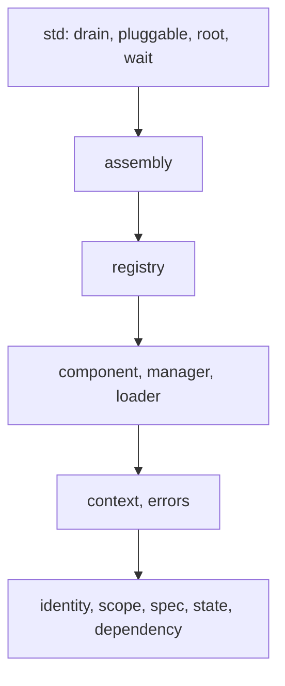

# Architecture

The package is a stack of layers; a module imports only from the layers below it. This page says how
the modules fit, and what holds across all of them.



An arrow means "imports from". A layer may also reach past its neighbour to anything below it —
`assembly` reads `scope` and `state` directly, `registry` reads `dependency` — but no layer reaches
upwards.

## The layers

| layer | modules | owns | may import |
|---|---|---|---|
| deployment | `std.*` | draining, waiting out a swap, answering from the root, moving a loaded module onto a new generation | the package surface |
| verbs | `assembly` | one instance per key, the rule a requirement is answered by, the batch verbs and their reports | everything below |
| order | `registry` | declarations, the identity graph, and the order they imply | declaration, lifetime, foundations |
| declaration | `component`, `manager`, `loader` | what a type declares, what drives an instance through its levels, what a path holds | lifetime, foundations |
| lifetime | `context`, `errors` | which call a read belongs to, and what the framework refuses | foundations |
| foundations | `identity`, `scope`, `spec`, `state`, `dependency` | who a component is, where effects go, what one requirement says, the four levels, the order | nothing inside the package |

Three imports say something the arrows cannot:

- `component` imports `context`, never the other way round: a field read asks whether it is inside a
  call. That is why `context.Rule` spells the resolver's shape out instead of importing `component`.
- `registry` imports `errors` for the refusal of an interface with nothing bound to it.
- `std.wait` imports `composat.errors` to refuse a key that is not in the table.

## Reading order

`identity` → `scope` → `spec` → `state` → `dependency` → `errors` → `context` → `component` →
`manager` → `loader` → `registry` → `assembly` → `std.*`. Each one only uses what is to its left, so
reading them in this order means never meeting a symbol that has not been introduced.

## What holds across the modules

1. **The table is the only record of what is up.** One instance per key
   ([ADR 0003](adr/0003-a-key-is-an-address.md)).
2. **A key has one writer.** A verb claims the keys it names and the keys it derives, for as long as it
   works on them; a second call is refused, not queued ([ADR 0005](adr/0005-one-writer-per-key.md)).
3. **An effect belongs to the innermost lifetime it is registered in.** A read during a call registers
   into the call; anywhere else, into the instance's epoch
   ([ADR 0006](adr/0006-effects-belong-to-the-innermost-lifetime.md)).
4. **A move commits its arrival before the hook runs**; a raising hook takes back its own step and no
   other ([ADR 0004](adr/0004-a-move-names-a-target.md)).
5. **Events are staged under the instance's lock and delivered outside it**, so an application handler
   never runs inside a move ([ADR 0005](adr/0005-one-writer-per-key.md)).
6. **A declaration and an instance are two facts.** A key can be declared and not up (a failed
   admission), and up under a declaration that has since been withdrawn — for a moment, by design
   ([ADR 0005](adr/0005-one-writer-per-key.md)).
7. **A qualifier is an opaque string, and no layer reads one.** A deployment that addresses two levels
   — an account and one endpoint of it — keeps both in the string and derives the places a requirement
   may be answered from in its own rule ([ADR 0003](adr/0003-a-key-is-an-address.md)); the shipped
   policy takes that derivation as `below=` ([below](#a-rule-with-levels-in-it)).

## A rule with levels in it

A deployment's addresses may carry more than one level, and the framework is not the one that knows
it: the places to try come out of the deployment's own function. `answering_from_the_root` takes it
as `below=` and adds the root after it, so an account-and-endpoint address and a process-wide
instance are answered by one policy rather than two that would have to agree:

```python
def two_levels(key: ComponentKey, identity: ComponentIdentity, /) -> tuple[ComponentKey, ...]:
    """The endpoint's own place, then the account it belongs to."""
    account, _, _endpoint = key.instance.partition("/")
    return (ComponentKey(identity, key.instance), ComponentKey(identity, account))


rule = answering_from_the_root(registry, up, only={Config, Pool}, below=two_levels)
```

Read in the order the list is built — the asker's own qualifier, then what `below` derives, then the
root — and closed over by `Assembly.start` the same way, so the account a read would fall back to is
one the batch brings up with its dependant. Nothing else widened: `only=` still says which identities
may cross to the root, and the account is only ever a place of the same identity.